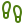
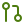

<!-- readme-standard: 2026-11-02 -->

# Wilson's Lawn Maintenance: the front door

*The business's own web page on GitHub: how to reach Jeff, a check-in for the crew, and what your lawn needs this month.*

 **You are here:** Wilson's Lawn Maintenance › `wilsonslawnmaintenance.github.io` · public · `main` is the working branch

##  TL;DR

1.  **What this is.** A small website for Wilson's Lawn Maintenance, at [wilsonslawnmaintenance.github.io](https://wilsonslawnmaintenance.github.io/). Three pages, nothing to sign in to.
2.  **Who it is for.** Customers (how to reach Jeff, and a month-by-month lawn card) and the crew (what to read first).
3.  **Do this first.** Open [your lawn this month](https://wilsonslawnmaintenance.github.io/lawn/).

Jeff, this one is yours. It says only what is already public: the work you do, where, and how to reach you. To book a job,
nothing changes: people call **(717) 825-8432**, email **Wilsonj84321@gmail.com**, or message the business on
[Facebook](https://www.facebook.com/WilsonslawnmaintenancePA/).

##  The pages

| Page | What it holds |
| --- | --- |
| [`/`](https://wilsonslawnmaintenance.github.io/) | Who the business is, how to reach it, and the way to the reading room, the procedures and the decks |
| [`/lawn/`](https://wilsonslawnmaintenance.github.io/lawn/) | Your lawn this month: a card for each month in south-central Pennsylvania, with a picture that changes with the season. Plainly general, not advice |
| [`/employees/`](https://wilsonslawnmaintenance.github.io/employees/) | The check-in for the crew: five things to read in order, the procedures, and how to ask for access. No sign-in, no forms |
| `404.html` | A friendly wrong turn, with the way back |

##  How it is built

- **No build step.** Every file is served as it is. Edit, commit, push to `main`; GitHub Pages publishes from the root of `main`.
- **One stylesheet,** [`site.css`](./site.css), in the business's greens (`365314`, `4d7c0f`, `65a30d`) with a dark mode that follows the visitor's device.
- **Icons are [Lucide](https://lucide.dev) (ISC),** written into each page as inline SVG.
- **The lawn card's words** live in [`lawn/lawn.js`](./lawn/lawn.js), one block per month: change a sentence there and push. They stay general on purpose: no products, no rates, no promises. The page points to [Penn State Extension](https://extension.psu.edu/) for anyone who wants the full guides.
- **Look before you push:** `python3 -m http.server` in this folder, then open `http://localhost:8000/`.

##  What it never does

No sign-in, no forms, no cookies, no analytics, no local storage, and no outside requests at all. The lawn page keeps a chosen month only in the address (`#month=apr`). No prices, no reviews and no crew names are written here: those are Jeff's to say.

##  Suggest a change

Noticed something? Open an [issue](../../issues) or a pull request against `main`; Christopher reads them and a person with the role merges (with a merge commit, never a squash). Not on GitHub? Just tell Jeff, or Christopher. Commit subjects start with one gitmoji ([GITMOJI.md](https://github.com/drasticstatic/my-template/blob/main/GITMOJI.md)); run `sh scripts/install-hooks.sh` once per clone.

The front door follows the living [README standard](https://github.com/drasticstatic/my-template/blob/main/README-STANDARD.md). Code MIT ([`LICENSE`](./LICENSE)); words CC BY-SA 4.0 ([`LICENSE-CONTENT`](./LICENSE-CONTENT)); the business's name and marks are its own ([`TRADEMARKS.md`](./TRADEMARKS.md)). Icons: Lucide (ISC). Kept ready by the drasticstatic lab, a brother's gift.
